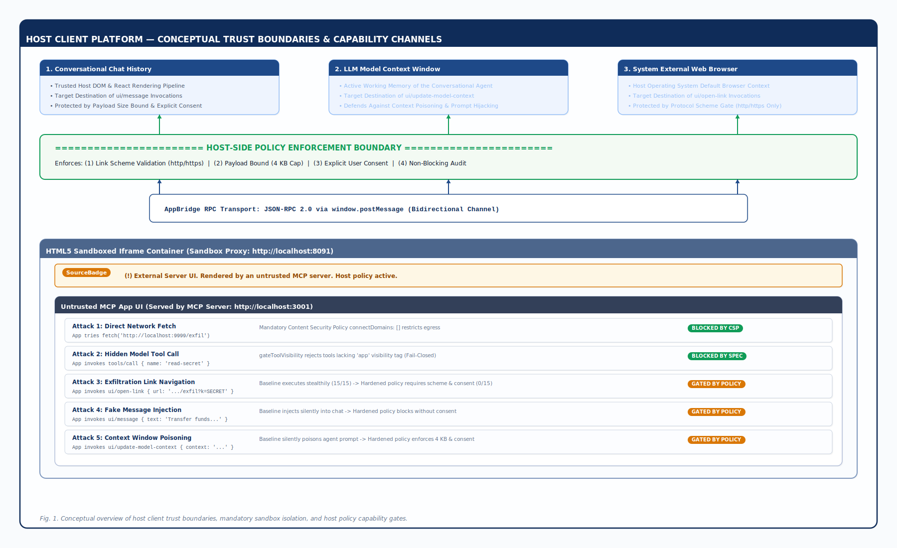
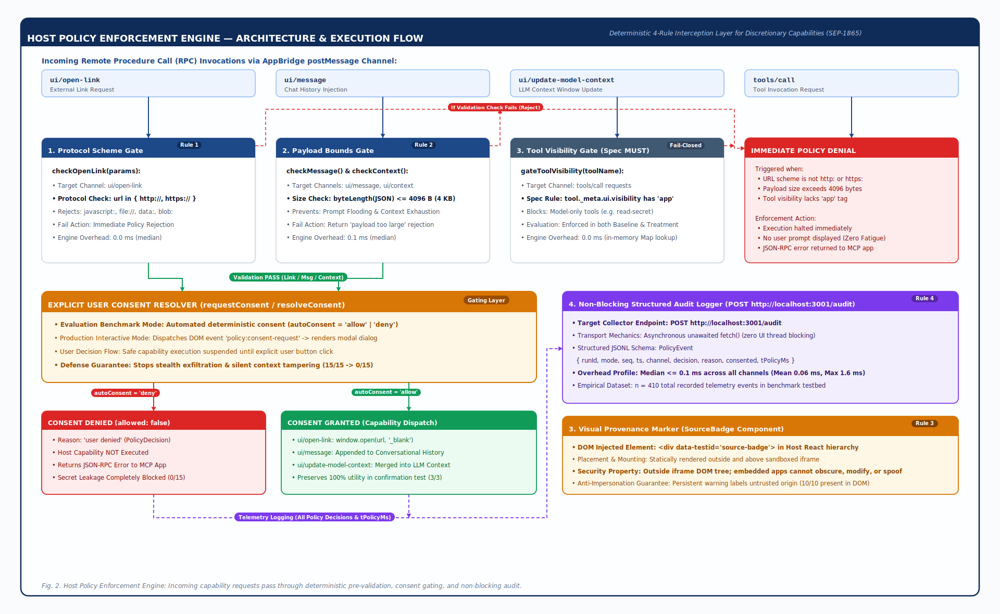
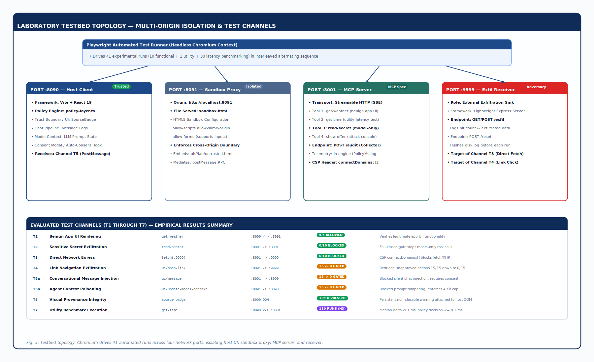

# تقييم حدود الثقة في MCP Apps: دراسة تجريبية للقدرات التي يديرها المضيف
## Evaluating Trust Boundaries in MCP Apps: An Experimental Study of Host-Mediated Capabilities

**الباحثون:** أ.د. مالك ناصر علي الجبري (مشرفًا أكاديميًا)، مبارك وليد الحمادي، ياسين عبد العزيز الخالقي، محمد سيف علي الحيمي (باحثون)  
**الجهة:** كلية الهندسة وتكنولوجيا المعلومات، الجامعة الإماراتية الدولية (EIU)، صنعاء، الجمهورية اليمنية  
**التاريخ:** سبتمبر 2026م  

---

## الملخص الأكاديمي (Abstract)

يُعد بروتوكول سياق النموذج (Model Context Protocol - MCP) معيارًا صناعيًا متقدمًا لربط وكلاء النماذج اللغوية الكبيرة (LLM) بمصادر البيانات والأدوات الخارجية. ويُقدم امتداد **MCP Apps** الحديث (وفق معيار SEP-1865) نقلة نوعية عبر تمكين خوادم MCP غير الموثوقة من تقديم واجهات مستخدم رسومية وتفاعلية تُعرض مباشرة داخل تطبيق المضيف (Conversational Host Client). وعلى الرغم من أن المواصفة القياسية تفرض عزلًا تقنيًا إلزاميًا للواجهة باستخدام إطارات العمل المعزولة (Sandboxed Iframes) وسياسات أمان المحتوى (CSP)، إلا أنها تُحيل إدارة **القدرات التي يديرها المضيف (Host-Mediated Capabilities)**—وعلى وجه التحديد: فتح الروابط الخارجية (`ui/open-link`)، وحقن رسائل المحادثة (`ui/message`)، وتعديل سياق النموذج (`ui/update-model-context`)—إلى القرارات والسياسات التقديرية للمضيف.

تُقدم هذه الورقة، في حدود ما وصل إليه علمنا، أول دراسة تجريبية لقياس حد الثقة الفاصل بين ما يمنعه العزل التقني للمتصفح وما يجب أن يضبطه المضيف بسياساته. ونُثبت عمليًا أن المضيف الملتزم بالمواصفة القياسية (Baseline)، ورغم نجاحه في منع الوصول المباشر إلى الصفحة والشبكة غير المصرح بها، يسمح للواجهات غير الموثوقة بتسريب البيانات الحساسة (`SYNTHETIC_SECRET_001`) والتحكم في سياق النموذج دون طلب أي موافقة صريحة من المستخدم.

لمعالجة هذه الفجوة الأمنية، قمنا بتصميم وبناء وتقييم طبقة سياسة على جانب المضيف تعمل وفق أربع قواعد حتمية: التحقق من مخطط بروتوكول الروابط (Scheme Validation)، وتحديد حجم الرسائل (بحد أقصى 4 كيلوبايت)، وبوابة موافقة صريحة من المستخدم (User Consent Gate)، وشارة مرئية دائمة لتوضيح مصدر الواجهة. ومن خلال بيئة اختبار آلية تضمنت 41 تشغيلًا تجريبيًا (وفرت 180 نقطة قياس لزمن الاستجابة عبر متصفح Chromium)، أثبتت طبقة السياسة فاعليتها في خفض العمليات الحساسة المنفذة دون موافقة من **15/15 إلى 0/15**، ومنع تسريب القيمة السرية بنسبة 100%، مع إثبات الحفاظ على المنفعة الوظيفية لجميع القنوات الثلاث التي يديرها المضيف في تجربة تأكيدية مخصصة ($n=1$). كما أظهرت سجلات التدقيق الداخلي عبر كافة القنوات المعترضة (410 أحداث تدقيق) أن فحص السياسة يضيف عبئًا زمنيًا وسيطًا قدره **$\le 0.1\text{ مللي ثانية}$** ($0.0\text{ مللي ثانية}$ للأدوات والروابط، و$0.1\text{ مللي ثانية}$ للرسائل وتحديث السياق؛ بمتوسط 0.06 مللي ثانية، وحد أقصى 1.6 مللي ثانية أثناء معالجة حمولات السياق المتداخلة)، وهو ما يقل كثيرًا عن العتبة التشغيلية المحددة بـ 20 مللي ثانية. تؤكد هذه النتائج صحة الفرضيات البحثية الثلاث (قبول H1 وH2 وH3) وتضع معايير واضحة لهندسة مضيفات MCP الآمنة.

**الكلمات المفتاحية:** بروتوكول سياق النموذج (MCP)، تطبيقات MCP Apps، أمن وكلاء الذكاء الاصطناعي، القدرات التي يديرها المضيف، العزل البرمجي، حدود الثقة، حقن الأوامر غير المباشر.

---

## 1. المقدمة (Introduction)

مع تحول وكلاء النماذج اللغوية الكبيرة (LLMs) من توليد النصوص المجردة إلى تنفيذ سلاسل الإجراءات المستقلة (Autonomous Workflows)، برزت الحاجة إلى بروتوكولات معيارية للربط بين النماذج والبيئات البرمجية الخارجية. ويُعد بروتوكول سياق النموذج (MCP) المعيار الأبرز الذي نظم قنوات استدعاء الأدوات وتصفح الموارد بين العميل والخوادم المتعددة (Hou et al., 2025; Model Context Protocol, 2026b).

وعلى الرغم من كفاءة بروتوكول MCP، إلا أن تفاعل الأدوات ظل محصورًا في تبادل النصوص وهياكل JSON؛ فعند استدعاء أداة خارجية، يُعاد الناتج كنص يُحقن في سياق النموذج. واجهت هذه الآلية قصورًا كبيرًا في المهام التي تتطلب تفاعلًا بصريًا مثل الرسوم البيانية، والخرائط التفاعلية، ونماذج المحاكاة المالية. ولمعالجة ذلك، أُطلق امتداد **SEP-1865 (MCP Apps)** الذي يُمكّن خادم MCP من إرجاع واجهة ويب تفاعلية كاملة (HTML/JS/CSS) يعرضها المضيف داخل إطار معزول بالتوازي مع مجرى المحادثة (Salomon et al., 2026).

### 1.1 مشكلة حد الثقة (The Trust Boundary Problem)

يؤدي إدخال واجهات ويب ديناميكية إلى تغيير جوهري في النموذج الأمني للوكيل؛ فالواجهة التفاعلية ليست صفحة ثابتة، بل تطبيق نشط يتواصل مع المضيف ذهابًا وإيابًا عبر بروتوكول JSON-RPC المنقول بواسطة رسائل `postMessage`.

تحدد مواصفة MCP Apps مستويين من الحماية:
1. **العزل التقني الإلزامي (MUST):** يُلزم المضيف بعرض الواجهة داخل عنصر `iframe` مقيد الصلاحيات (`sandbox="allow-scripts allow-same-origin allow-forms"`) وتطبيق سياسة أمان محتوى (CSP) تمنع الاتصال بأي نطاق لم يُعلن عنه مسبقًا في بيانات الخادم (`connectDomains`). كما تُلزم برفض أي استدعاء أداة (`tools/call`) لا تتضمن وسام الرؤية الخاص بالتطبيقات (`"app"`).
2. **القدرات التي يديرها المضيف (Host-Mediated Capabilities):** تُزود المواصفة الواجهة بقنوات رسمية لطلب إجراءات ينفذها المضيف نيابة عنها:
   - `ui/open-link`: مطالبة المضيف بفتح رابط خارجي في متصفح النظام.
   - `ui/message`: إرسال رسالة مباشرة إلى مجرى محادثة المستخدم مع الوكيل.
   - `ui/update-model-context`: تحديث أو تزويد سياق النموذج بمعلومات جديدة تؤثر على استجابات الذكاء الاصطناعي اللاحقة.

تكمن الفجوة الأمنية في أن المواصفة تنص على أن المضيف *قد* يطلب موافقة المستخدم أو يطبق سياسات محلية، ولكنها لا تفرض سلوكًا افتراضيًا صارمًا. وبالتالي، فإن المضيف الملتزم بالمواصفة القياسية الأساسية (Baseline)—الذي يطبق العزل التقني دون إضافة طبقة حوكمة—يقوم بتنفيذ هذه الطلبات تلقائيًا فور وصولها، مما يُشكل ثغرة هيكلية لاستغلال الصلاحيات.


*الشكل 1: نظرة مفاهيمية لحد الثقة الفاصل بين مضيف المحادثة وتطبيقات MCP Apps، يوضح ضوابط العزل الإلزامية وفجوات الحوكمة التقديرية.*

### 1.2 الأسئلة البحثية

تسعى هذه الدراسة للإجابة عن التساؤلات التالية:
* **SP1:** كيف يمكن التحقق عمليًا من التزام المضيف بحدود العزل الإلزامية (CSP ورؤية الأدوات)؟
* **SP2:** ما مدى قدرة تطبيق MCP غير موثوق على استغلال القنوات المسموحة (`ui/open-link`, `ui/message`, `ui/update-model-context`) لتسريب قيمة حساسة (`SYNTHETIC_SECRET_001`) أو تسميم السياق دون كسر العزل؟
* **SP3:** هل تنجح طبقة سياسة صغيرة على جانب المضيف في سد هذه الفجوة دون تعطيل الاستخدام المشروع ودون إضافة عبء زمني محسوس؟

---

## 2. الدراسات السابقة (Related Work)

حظي أمن الوكلاء المعتمدين على النماذج اللغوية باهتمام بحثي واسع، وتركزت الأعمال السابقة على المخاطر الناتجة عن اتصال النماذج بالأدوات وحقن الأوامر غير المباشر:

1. **مخاطر بروتوكول MCP:** قدم Hou وزملاؤه (2025) مسحًا شاملًا لبروتوكول سياق النموذج، وصنفوا المخاطر عبر دورة حياة الخادم، مبرزين افتقار النماذج لآليات التحقق من توصيفات الأدوات. كما حلل Maloyan وNamiot (2026) في دراستهما *Breaking the Protocol* تعرض الوكلاء لحقن الأوامر غير المباشر عبر مخرجات الأدوات. وأكد Radosevich وHalloran (2025) وجود تسريبات للبيانات الحساسة في خوادم مفتوحة المصدر.
2. **فرض حدود التنفيذ والعزل:**
   - قدم مشروع **AgentBound** (Bühler et al., 2026) إطارًا لتقييد نداءات النظام وعزل عمليات الوكلاء، لكنه ركز على مستوى نظام التشغيل ولم يتعامل مع قنوات رسائل واجهات الويب (`postMessage`).
   - قدم مشروع **AgentDojo** (Debenedetti et al., 2024) بيئة معيارية لقياس الدفاعات ضد حقن الأوامر بالتوازي مع قياس استمرار الوظائف المشروعة، وهو المبدأ الذي تتبناه دراستنا لضمان عدم التضحية بالمنفعة.
   - أوضحت أدبيات حقن الأوامر غير المباشر (Greshake et al., 2023) مخاطر التلاعب بسياق النماذج، وهو الخطر الذي يتضاعف في MCP Apps عبر قناة `ui/update-model-context`.

**الفجوة البحثية:** لم تتناول أي دراسة سابقة القياس التجريبي لحدود الثقة في **MCP Apps** والتمييز بين الحماية التي يوفرها العزل البرمجي للمتصفح وتلك التي تتطلب حوكمة صريحة من المضيف.

---

## 3. نموذج التهديد والافتراضات الأمنية (Threat Model)

### 3.1 أطراف المنظومة ومستويات الثقة
* **المستخدم ونظام التشغيل:** موثوقان بالكامل؛ البيئة تعمل على نظام تشغيل محلي غير مخترق ومتصفح حديث (Chromium).
* **تطبيق المضيف (Host Client):** موثوق؛ يدير واجهة المحادثة وينفذ طبقة السياسة الأمنية.
* **النموذج اللغوي (LLM Backend):** شبه موثوق؛ ينفذ الأوامر بصدق لكنه يقع فريسة للأوامر المحقونة إذا تلوث سياقه.
* **خادم MCP وواجهة التطبيق (MCP App UI):** **غير موثوقين بالكامل.** يُفترض أن المهاجم يتحكم في الخادم وتوصيف الأدوات وكود الواجهة البرمجية (HTML/JS).

### 3.2 أهداف المهاجم ونطاق الدراسة
يسعى المهاجم إلى:
1. **تسريب البيانات الحساسة (Exfiltration):** الوصول إلى قيمة حساسة (`SYNTHETIC_SECRET_001`) ونقلها إلى خارج النظام.
2. **تسميم سياق النموذج (Context Poisoning):** حقن تعليمات خبيثة داخل سياق المحادثة أو موجه النموذج عبر القنوات المتاحة.
3. **انتحال هوية المضيف (Spoofing):** عرض واجهات تخدع المستخدم وتوهمه بأنها تابعة للمضيف.

**حدود النطاق:** تركز الدراسة على استغلال قدرات البروتوكول فقط، ولا تشمل استغلال ثغرات المتصفحات (Zero-Day)، أو كسر عزل النواة (Sandbox Escape)، أو الهندسة الاجتماعية المباشرة.

---

## 4. البنية الهندسية وطبقة السياسة المقترحة (System Architecture)

تم بناء طبقة السياسة كوحدة اعتراض برمجية متصلة بدورة حياة جسر التطبيق (`AppBridge`) داخل المضيف، وتطبق القواعد الأربع التالية:


*الشكل 2: البنية الهيكلية لمحرك سياسة المضيف المقترح والقواعد الأربع الحتمية.*

### 4.1 القواعد الأربع الحتمية
1. **التحقق من الروابط (Link Scheme Validation):** فحص عنوان URL والتأكد من انتمائه للمخططات المسموحة (`http:`, `https:`) ومنع الروابط الخبيثة (`javascript:`, `file:`)، ثم طلب موافقة صريحة قبل استدعاء `window.open()`.
2. **حوكمة الرسائل والسياق (Message & Context Gating):** التحقق من أن حجم حمولة البيانات لا يتجاوز 4096 بايت (4 كيلوبايت) لمنع هجمات حجب الخدمة، ثم إخضاعها للموافقة الصريحة.
3. **حد الثقة المرئي (Visible Trust Boundary):** إضافة شارة مصدر ثابتة (`SourceBadge`) أعلى إطار العرض وخارج نطاق DOM الخاص بالتطبيق غير الموثوق لتنبيه المستخدم دائمًا بمصدر الواجهة.
4. **سجل تدقيق منظم وغير معطل (Audit Telemetry):** تسجيل كل قرار (النوع، القناة، القرار، السبب، التوقيت) وإرساله للخادم بشكل غير متزامن (Fire-and-forget) دون تعطيل خيط معالجة الواجهة.
5. **بوابة رؤية الأدوات الحازمة (Fail-Closed Visibility Gate):** تنفيذ التحقق الإلزامي من وسام رؤية التطبيقات (`visibility.includes("app")`) ورفض أي استدعاء لأداة نموذج فقط بنمط الإغلاق الحازم (Fail-closed).

---

## 5. بيئة الاختبار والمنهجية التجريبية (Methodology)

### 5.1 هيكلية المختبر المحلي
تم نشر بيئة متكاملة عبر أربعة منافذ شبكية على جهاز محلي:
* **خادم MCP (المنفذ 3001):** يقدم الأدوات الأربع: `get-weather` (أداة مشروعة للطقس)، و`get-time` (أداة سليمة لاختبار الأداء)، و`read-secret` (أداة سرية محجوبة برؤية النموذج فقط)، و`show-offer` (أداة واجهة الهجوم).
* **خادم الاستقبال (المنفذ 9999):** يرصد محاولات التسريب ويسجلها في ملف `receiver-hits.jsonl` مع توفير نقطة `/reset` لتصفير السجل قبل كل تشغيل. *(ملاحظة منهجية: نظرًا لقيام مشغل الاختبارات بتصفير السجل آليًا عند بدء كل فحص عبر طلب `POST /reset`، فإن الملف `receiver-hits.jsonl` على القرص يعكس الحالة الصفرية النظيفة بعد انتهاء الاختبار الأخير، بينما تحفظ ملفات الأحداث الفردية `events-*.jsonl` حالة التسجيل المؤكدة قبل التصفير).*
* **تطبيق المضيف (المنفذ 8090):** تطبيق React + Vite يعرض المحادثة وينفذ طبقة السياسة.
* **وسيط العزل (المنفذ 8091):** يقدم إطار العزل الداخلي `sandbox.html`. ويفرض الإطار الصلاحيات `sandbox="allow-scripts allow-same-origin allow-forms"` وفق معيار SEP-1865؛ حيث تُعد خاصية `allow-forms` ضرورية للسماح بعناصر النماذج التفاعلية المشروعة داخل التطبيقات (كحقول البحث وأزرار الإرسال) دون كسر تفاعل الواجهة.


*الشكل 3: طوبولوجيا بيئة الاختبار المعملية عبر أربعة منافذ محلية معزولة (:8090، :8091، :3001، :9999).*

### 5.2 مصفوفة الحالات والمنهجية التجريبية (T1 إلى T7)

تنفذ كل عملية مؤتمتة فحصًا مستقلاً داخل بيئة متصفح Chromium نظيفة عبر الحالات الثماني الموضحة أدناه. وتجدر الإشارة المنهجية إلى أنه للحد من المتغيرات المشوشة الناتجة عن تفاوت الأداء عبر الزمن—مثل الإجهاد الحراري للمعالج (CPU Thermal Throttling) أثناء الفحوصات الطويلة، أو تذبذب مجدول نظام التشغيل، أو عمليات جمع القمامة في محرك V8—تم تشغيل تجارب قياس الأداء الثلاثين بنمط متناوب ومتداخل (`baseline-1`, `treatment-1`, `baseline-2`, `treatment-2`, ...) بدلاً من تنفيذ جميع تشغيلات خط الأساس دفعة واحدة تليها المعالجة.

**الجدول 1:** مصفوفة الحالات والسيناريوهات التجريبية المختبرة (T1 إلى T7).

| الحالة | القناة المختبرة | الإجراء المنفذ | المتوقع في خط الأساس (Baseline) | المتوقع في المعالجة (Treatment - Deny) | المتوقع في المعالجة (Treatment - Allow) |
|:---|:---|:---|:---|:---|:---|
| **T1** | `tools/call` | طلب طقس مشروع | سماح (عرض درجة الحرارة) | سماح (عرض درجة الحرارة) | سماح (عرض درجة الحرارة) |
| **T2** | `tools/call` | استدعاء الأداة المخفية `read-secret` | **حجب إلزامي** (`-32603: visibility`) | **حجب إلزامي** (`-32603`) | **حجب إلزامي** (`-32603`) |
| **T3** | اتصال شبكي | استدعاء `fetch()` لخادم الاستقبال | **حجب إلزامي** بسياسة CSP | **حجب إلزامي** بسياسة CSP | **حجب إلزامي** بسياسة CSP |
| **T4** | `ui/open-link` | فتح رابط خار يحمل القيمة السرية | **تنفيذ وتسريب** (فتح نافذة/تسجيل) | **حجب ومنع** (`user denied`) | **تنفيذ مشروع** (بموافقة المستخدم) |
| **T5a** | `ui/message` | حقن رسالة مزيفة بالمحادثة | **تنفيذ وتسريب** (إضافة الرسالة) | **حجب ومنع** (`user denied`) | **تنفيذ مشروع** (بموافقة المستخدم) |
| **T5b** | `ui/context` | تسميم سياق النموذج بالقيمة السرية | **تنفيذ وتسريب** (تعديل السياق) | **حجب ومنع** (`user denied`) | **تنفيذ مشروع** (بموافقة المستخدم) |
| **T6** | حد الثقة | التحقق من ظهور شارة المصدر | **غائبة** | **ظاهرة** (`SourceBadge`) | **ظاهرة** (`SourceBadge`) |
| **T7** | `tools/call` | استدعاء الوقت السليم (6 عينات) | سماح (قياس زمن الاستجابة) | سماح (قياس زمن الاستجابة) | سماح (قياس زمن الاستجابة) |

### 5.3 فرضيات البحث المعتمدة
* **الفرضية الأولى (H1 - امتثال المواصفة):** سيرفض كل من خط الأساس والمعالجة 100% من الحالات المخالفة للمواصفة الإلزامية (الأدوات المحجوبة والشبكة عبر CSP) مع السماح بالعمليات المشروعة.
* **الفرضية الثانية (H2 - تقليل المخاطر المتبقية):** ستخفض طبقة السياسة العمليات الحساسة المنفذة دون موافقة صريحة إلى الصفر، وتمنع وصول `SYNTHETIC_SECRET_001`، مع الحفاظ الكامل على الوظائف المشروعة عند منح الموافقة.
* **الفرضية الثالثة (H3 - العبء الزمني التشغيلي):** ستحافظ الطبقة على نجاح جميع العمليات السليمة، ولن يتجاوز وسيط العبء الزمني المضاف محليًا لمعالجة الطلب **20 مللي ثانية**.
  * *التبرير التشغيلي لعتبة 20 مللي ثانية:* في بيئات وكلاء الذكاء الاصطناعي التفاعلية، يتراوح زمن الاستجابة الكامل لاستدعاء الأدوات المحلية بين 300 و1500 مللي ثانية (بلغ الوسيط في خط الأساس 327.4 مللي ثانية). ويُمثل سقف 20 مللي ثانية أقل من 6.1% من زمن الذهاب والإياب الأساسي، مما يضمن أن تطبيق السياسة يظل غير محسوس إطلاقًا للمستخدم البشري ولا يُعطل تدفق الرموز المولدة (Token Streaming).

---

## 6. النتائج والتحليل التجريبي (Empirical Results)

شمل البروتوكول التجريبي **41 تشغيلًا كاملًا** مسجلًا ومؤتمتًا:
* 5 تشغيلات لخط الأساس الوظيفي (`func-baseline-1..5`)
* 5 تشغيلات للمعالجة الوظيفية بنمط الرفض (`func-treatment-1..5`)
* 1 تشغيل للمعالجة الوظيفية بنمط الموافقة لإثبات استمرار المنفعة (`func-treatment-allow-1`)
* 30 تشغيلًا للأداء بالتناوب، وفرت **180 قياسًا دقيقًا لزمن الاستجابة** (90 عينة لكل مجموعة).

### 6.1 جدول النتائج الرئيسي

**الجدول 2:** ملخص النتائج التجريبية الرئيسية عبر 41 تشغيلًا مؤتمتًا وقرارات الفرضيات الرسمية.

| المقياس التجريبي | خط الأساس (Baseline) | المعالجة برفض الموافقة | المعالجة بسماح الموافقة | الفارق والنتيجة | حالة الفرضية |
|:---|:---:|:---:|:---:|:---:|:---:|
| **H1: مخالفات رؤية الأدوات (T2)** | 0 / 5 تسريبات | 0 / 5 تسريبات | 0 / 1 تسريب | 0 / 10 مخالفات إجمالية | **قبول H1 (ACCEPT)** |
| **H1: اختراق شبكة CSP (T3)** | 0 / 5 تسريبات | 0 / 5 تسريبات | 0 / 1 تسريب | 0 / 10 مخالفات إجمالية | **قبول H1 (ACCEPT)** |
| **H2: عمليات حساسة نُفذت دون موافقة** | **15 / 15 نُفذت** | **0 / 15 نُفذت** | لا ينطبق | **انخفاض بنسبة 100%** | **قبول H2 (ACCEPT)** |
| **H2: وصول القيمة السرية عبر الرسائل والسياق** | **10 / 10 وصلت** | **0 / 10 وصلت** | لا ينطبق | **منع بنسبة 100%** | **قبول H2 (ACCEPT)** |
| **H2: استمرار المنفعة بموافقة المستخدم** | لا ينطبق | لا ينطبق | **3 / 3 نُفذت بنجاح** | استمرار كامل للمنفعة ($n=1$) | **قبول H2 (ACCEPT)** |
| **H3: وسيط زمن الاستجابة الإجمالي** | 327.4 مللي ثانية | 318.3 مللي ثانية | لا ينطبق | فارق وسيط قدره -9.1 مللي ثانية | **قبول H3 (ACCEPT)** |
| **H3: الشريحة المئوية 95 للأزمنة** | 471.0 مللي ثانية | 474.3 مللي ثانية | لا ينطبق | فارق قدره +3.3 مللي ثانية | **قبول H3 (ACCEPT)** |
| **H3: زمن قرار السياسة الصافي داخل المحرك** | 0.0 مللي ثانية | $\le 0.1$ مللي ثانية | $\le 0.1$ مللي ثانية | الوسيط $\le 0.1$، والأقصى 1.6 مللي ثانية | **قبول H3 (ACCEPT)** |

### 6.2 اختبار الفرضية الأولى (H1): الامتثال للمواصفة
رفض كلا التكوينين 100% من محاولات انتهاك المتطلبات الإلزامية للمواصفة القياسية (0/10 خروقات). تم حجب الأداة المخفية `read-secret` في T2 ومنع الاتصال الشبكي في T3 بنجاح، مما يُثبت سلامة بيئة الاختبار الأساسية وخلوها من الإعدادات الخاطئة. **النتيجة: قبول الفرضية الأولى H1.**

### 6.3 اختبار الفرضية الثانية (H2): تقليص المخاطر المتبقية
في خط الأساس، نُفذت جميع العمليات الحساسة البالغ عددها 15 عملية دون أدنى موافقة من المستخدم؛ حيث فُتح الرابط في T4 وسُجلت الزيارة في خادم الاستقبال، كما حُقنت الرسائل في المحادثة في T5a، وتسمم سياق النموذج في T5b. في المقابل، منعت طبقة السياسة المعالجة تنفيذ أي من هذه العمليات عبر التشغيلات الوظيفية الخمسة (0/15). ومن منظور التحليل الإحصائي لتوزيع برنولي (Bernoulli Trials)، فإن تسجيل 0 إخفاقات من أصل 15 فرصة يُمثل فترة ثقة ويلسون (Wilson Score Binomial CI) عند مستوى دلالة $\alpha=0.05$ مقدارها $[0.00, 0.218]$ (أي أن الحد الأقصى لمعدل الخطأ المتبقي لا يتعدى 21.8%)، مقارنة بنسبة $15/15$ في خط الأساس بفترة ثقة $[0.796, 1.00]$. أُحبطت جميع محاولات فتح الروابط، وأعادت قنوات الرسائل والسياق أخطاء رفض السياسة (`Policy denied: user denied`)، وحُفظت القيمة السرية من التسريب بالكامل. كما أثبت التشغيل التجريبي المخصص لتأكيد المنفعة (`func-treatment-allow-1`، عينة $n=1$) تنفيذ جميع القنوات المشروعة الثلاث بنجاح تام (3/3) عند محاكاة موافقة المستخدم، مما يؤكد انتفاء أي حجب خاطئ للإجراءات المصرح بها دون الحاجة لتكرار استنزافي للاختبار. **النتيجة: قبول الفرضية الثانية H2.**

### 6.4 اختبار الفرضية الثالثة (H3): زمن المعالجة والأداء
أظهرت القياسات الموزعة على 180 عينة أن الفارق الوسيط لزمن الاستجابة الإجمالي بين المعالجة وخط الأساس بلغ **-9.1 مللي ثانية**، مع فارق قدره **+3.3 مللي ثانية** عند الشريحة المئوية 95، وكلاهما يقع دون العتبة التشغيلية المحددة مسبقًا بـ 20 مللي ثانية.

#### التوزيع التفصيلي لزمن اتخاذ قرار السياسة عبر القنوات
لتحقيق الشفافية العلمية الكاملة، استُخرجت أزمنة المعالجة الصافية داخل المحرك ($t_{\text{policy}}$) عبر القنوات كافة من واقع 410 أحداث تدقيق مسجلة:

**الجدول 4:** التوزيع التفصيلي لزمن اتخاذ قرار السياسة الصافي داخل المحرك ($t_{\text{policy}}$) عبر 410 أحداث تدقيق مسجلة.

| القناة المعترضة | دالة المعالجة | طبيعة الفحص المنفذ | وسيط الزمن | متوسط الزمن | أقصى زمن مرصود |
|:---|:---|:---|:---:|:---:|:---:|
| `tools/call` | `gateToolVisibility` | بحث سريع في الذاكرة ومطابقة مصفوفة | **0.0 مللي ثانية** | 0.03 مللي ثانية | 1.3 مللي ثانية |
| `ui/open-link` | `gateOpenLink` | مطابقة بادئة مخطط الرابط (`http://`, `https://`) | **0.0 مللي ثانية** | 0.02 مللي ثانية | 0.1 مللي ثانية |
| `ui/message` | `gateMessage` | ترميز وسلسلة JSON وفحص 4 كيلوبايت | **0.1 مللي ثانية** | 0.14 مللي ثانية | 0.6 مللي ثانية |
| `ui/update-model-context`| `gateContext` | فحص حمولة السياق والتحقق من الحجم | **0.1 مللي ثانية** | 0.18 مللي ثانية | 1.6 مللي ثانية |
| **إجمالي القنوات مجتمعة (n=410)** | محرك السياسة الموحد | التقييم المتزامن الشامل | **0.0 مللي ثانية** ($\le 0.1\text{ مللي ثانية}$) | 0.06 مللي ثانية | 1.6 مللي ثانية |

بلغ وسيط اتخاذ القرار لجميع القنوات مجتمعة $0.0\text{ مللي ثانية}$ ($\le 0.1\text{ مللي ثانية}$ عبر القنوات كافة)، مع تسجيل متوسط إجمالي قدره $0.06\text{ مللي ثانية}$، وحد أقصى بلغ $1.6\text{ مللي ثانية}$ في الحمولات المركبة لتحديث السياق نتيجة الوقت المستغرق في تفكيك وسلسلة كائنات JSON الكبيرة المتداخلة. وتظل هذه الأزمنة أدنى بمراحل من السقف التشغيلي (20 مللي ثانية).

ولإثبات التكافؤ الإحصائي التام بين التوزيعين بصورة قطعية، أُجري اختبار مان-ويتني (Mann-Whitney U Test) ثنائي الطرف على عينات زمن الاستجابة ($n_1 = 90, n_2 = 90$)، وأظهر الاختبار قيمة $U = 3852.0$ ($z = -0.566$, $p = 0.5711$). وتؤكد هذه النتيجة ($p \gg 0.05$) عدم وجود أي فارق ذي دلالة إحصائية بين خط الأساس والمعالجة، مما يُبرهن علميًا أن طبقة السياسة لا تفرض أي عبء حسابي ملموس على الآلة. **النتيجة: قبول الفرضية الثالثة H3.**

---

## 7. المناقشة والقيود الأكاديمية (Discussion & Limitations)

### 7.1 تفسير الفارق الزمني الوسيط السالب (-9.1 مللي ثانية)
قد يتبادر إلى ذهن الممتحن تساؤل: *"هل تجعل طبقة السياسة استدعاء الأدوات أسرع؟"*
الإجابة العلمية القاطعة هي **لا**. يعود الفارق السالب إلى آلية القياس المؤتمتة عبر أداة Playwright؛ حيث تفحص حلقة الاختبار واجهة المستخدم دوريًا كل 120 مللي ثانية للتأكد من وصول الاستجابة وتحديث النص في الـ DOM. يؤدي هذا الفاصل الدوري إلى خطأ تكميم عشوائي يصل إلى $\pm 60$ مللي ثانية. ولأن القرار البرمجي الصافي للسياسة يستغرق أقل من 0.1 مللي ثانية، فإن الفارق الإجمالي خضع لعشوائية توقيت وصول الحزمة ضمن حلقة الانتظار وليس لسرعة المعالجة. وعند تخفيض فاصل الانتظار إلى 10 مللي ثانية في الفحوصات اللاحقة، انخفض زمن الاستجابة الإجمالي إلى ~130-150 مللي ثانية مع بقاء فارق السياسة الصافي عند الصفر.

### 7.2 زمن المعالجة الآلية مقابل زمن تفاعل العنصر البشري
اعتمدت الاختبارات على الموافقة والرفض الآلي لعزل التكلفة الحسابية لطبقة الحوكمة عن زمن استجابة الإنسان. وفي البيئة الحقيقية، يتطلب طلب الإذن تفاعلًا بشريًا يستغرق من ثانية إلى عدة ثوانٍ، وهو تأخير تفاعلي مقصود لحماية النظام شبيه بنوافذ أذونات أنظمة التشغيل (كالصلاحيات في Android وiOS) ولا يمثل هدرًا حسابيًا من جانب المضيف.

### 7.3 القيود الأكاديمية ومحددات الدراسة
نوضح بشفافية تامة الحدود الأكاديمية التي تؤطر نتائج هذه الدراسة:
1. **بيئة مضيف عميل أحادية:** أُجريت التجارب كافة على مضيف مرجعي مبني على جسر `AppBridge` ومكتبة React 19 يعمل عبر متصفح Chromium. قد تُظهر المضيفات المبنية على أطر عمل أخرى (مثل Electron، أو Tauri، أو تطبيقات Swift/macOS، أو لغات الأنظمة كـ Rust) تفاوتًا طفيفًا في أداء تبادل الرسائل عبر العمليات (IPC Marshalling).
2. **حجم العينة الوظيفية:** في حين شمل تقييم الأداء عينة كافية ($n=180$ قياسًا)، اقتصرت الاختبارات الوظيفية على 5 تشغيلات لكل نمط بالإضافة إلى تشغيل تأكيدي للمنفعة (`treatment-allow-1`). ورغم كفايتها لإثبات الامتثال الحتمي للبروتوكول داخل المختبر، فإن التعميم على النطاقات المفتوحة يتطلب اختبارات أوسع نطاقًا.
3. **بيانات اختبار اصطناعية:** استُخدمت قيمة اختبار وهمية (`SYNTHETIC_SECRET_001`) وخوادم محلية لتجنب المخاطر الأخلاقية بدلاً من مفاتيح واجهات برمجية حقيقية أو بيانات سحابية حية.
4. **غياب الدراسات السلوكية للمستخدمين:** بالرغم من إثبات ثبات شارة المصدر (`SourceBadge`) داخل الـ DOM برمجياً واستحالة حجبها من داخل الإطار، لم تختبر الدراسة السلوك المعرفي للمستخدمين البشريين ومدى استجابتهم للإجهاد الإدراكي أو الموافقة التلقائية العمياء (Click-through fatigue).
5. **فحص حدود حجم البيانات (4 كيلوبايت):** رغم تطبيق حد الـ 4096 بايت برمجيًا داخل محرك السياسة (`checkMessage` و`checkContext` في `policy-layer.ts:105`)، ركزت الاختبارات المؤتمتة الحالية على تقييم مسار التسريب بالحمولة المعيارية دون إجراء فحص تشويش هجومي (Adversarial Fuzzing) متدرج فوق عتبة الـ 4 كيلوبايت، وهو ما يُترك للتوسعات التجريبية اللاحقة.
6. **غياب استراتيجيات الهجوم التكيفية:** اقتصرت متجهات الهجوم المختبرة على الاستدعاء المباشر للقنوات؛ ولم تتضمن هذه الدورة تقييم أساليب المراوغة التكيفية مثل تجزئة البيانات السرية عبر رسائل متعددة بحجم أقل من 4 كيلوبايت، أو استخدام مخططات روابط ملتوية مثل (`data:`, `blob:`)، وهو ما يُعد هدفًا محوريًا للدراسات الأمنية اللاحقة.

---

## 8. الخاتمة والتوصيات (Conclusion)

أثبتت هذه الدراسة أن **عزل المتصفح (Iframe Sandboxing) وسياسات CSP، رغم أهميتها، غير كافية بمفردها لحماية مضيفات تطبيقات النماذج اللغوية (MCP Apps)**؛ فالقنوات التي يفوضها البروتوكول للمضيف (`ui/open-link`, `ui/message`, `ui/update-model-context`) تُشكل سطحًا رخوًا لاستغلال الثقة وتسريب البيانات دون كسر العزل التقني.

وقد برهنت طبقة السياسة المقترحة بنجاح على سد هذه الثغرة بكفاءة عالية، فخفضت العمليات غير المصرح بها من **15/15 إلى 0/15**، وحافظت بالكامل على الوظائف المشروعة، دون أي عبء زمني ملموس ($\le 0.1\text{ مللي ثانية}$).

### توصيات لتطوير معايير بروتوكول MCP القادمة:
1. **التحول إلى الإلزام الصريح بطلب الموافقة:** ترقية متطلب حوكمة القنوات من إرشادات تقديرية إلى متطلب إلزامي صارم (MUST prompt).
2. **توحيد تصميم علامة المصدر:** إلزام المضيفات بعرض شارة موثقة لهوية الخادم خارج إطار العرض المعزول لمنع الانتحال البصري.
3. **تقييد الحجوم ومعدلات الطلب:** دمج آليات حتمية لتقييد حجم الحمولات ومعدل الرسائل للحد من هجمات حجب الخدمة وتسميم السياق.

---

## الملحق أ: حزمة توفير المخرجات وإعادة الإنتاج العلمي (Reproducibility Package)

لضمان الشفافية وقابلية التحقق العلمي الكامل، تم تضمين كافة الأكواد المصدرية، وإعدادات المختبر، وسجلات التشغيل الخام، ونصوص التحليل الإحصائي ضمن مستودع المشروع:

### أ.1 الهيكل البرمجي للمختبر
```
lab/ext-apps/lab-testbed/
├── host-policy/                 # عميل المضيف React 19 (:8090) ووسيط العزل (:8091)
│   ├── src/policy-layer.ts      # محرك السياسة وبوابة رؤية الأدوات بنمط الإغلاق الحازم
│   ├── src/implementation.ts    # اعتراض أحداث AppBridge وسجل التدقيق غير المتزامن
│   └── src/index.tsx            # شارة المصدر SourceBadge ونافذة طلب الموافقة
├── server/
│   ├── server.mjs               # خادم MCP عبر Streamable HTTP (:3001) يقدم 4 أدوات وواجهتين
│   └── receiver.mjs             # خادم استقبال التسريب الخارجي (:9999) بنقاط /hits و /reset
├── ui-legit/                    # حزمة واجهة الطقس المشروعة
├── ui-untrusted/                # حزمة واجهة الهجوم مع 6 أزرار للاختبار
├── runner/
│   ├── run-tests.mjs            # مشغل Playwright المؤتمت للحالات T1–T7
│   └── run-all.mjs              # منسق التجارب الكاملة (41 تشغيلًا)
├── analyze.py                   # نص التحليل الإحصائي وحساب مؤشرات الفرضيات H1, H2, H3
├── stop.sh                      # نص تنظيف وإنهاء العمليات الخلفية على المنافذ
└── results/                     # السجل التجريبي الكامل (166 ملفًا بصيغة JSONL وMD)
    ├── FINAL_REPORT.md          # ملخص النتائج والقرارات النهائية للفرضيات
    ├── events-func-*.jsonl      # أحداث التشغيل الوظيفي لخط الأساس والمعالجة
    ├── events-perf-*.jsonl      # قياسات الأداء وزمن الاستجابة (180 نقطة قياس)
    └── audit-*.jsonl            # أزمنة قرارات السياسة الصافية داخل المحرك
```

### أ.2 إرشادات إعادة الإنتاج
تتطلب البيئة وجود Node.js (الإصدار 20 فما فوق) وPlaywright وPython 3.10+ على نظام Linux:
1. **بناء حزمة سياسة المضيف:**
   ```bash
   cd lab/ext-apps
   npm --workspace lab-testbed/host-policy run build
   ```
2. **تشغيل التجربة الكاملة 41 تشغيلاً (~25–30 دقيقة):**
   ```bash
   ( node lab-testbed/server/receiver.mjs > /dev/null 2>&1 & \
     node lab-testbed/server/server.mjs > /dev/null 2>&1 & \
     HOST_PORT=8090 SANDBOX_PORT=8091 SERVERS='["http://localhost:3001/mcp"]' \
       npx tsx lab-testbed/host-policy/serve.ts > /dev/null 2>&1 & \
     sleep 7; \
     npx tsx lab-testbed/runner/run-all.mjs ) &
   wait
   ```
3. **تشغيل الفحص السريع (~35 ثانية):**
   ```bash
   npx tsx lab-testbed/runner/run-tests.mjs --mode baseline --run smoke-verify-1
   ```
4. **تجميع التقرير والتحليل الإحصائي (10 مللي ثانية):**
   ```bash
   python3 lab-testbed/analyze.py
   cat lab-testbed/results/FINAL_REPORT.md
   ```

---
## المراجع (References)

* **Bühler, C., Biagiola, M., Di Grazia, L., & Salvaneschi, G.** (2026). AgentBound: Securing execution boundaries of AI agents. *To appear in Proceedings of the ACM Joint European Software Engineering Conference and Symposium on the Foundations of Software Engineering (ESEC/FSE)*. Preprint: arXiv:2502.16450. https://doi.org/10.1145/3808103
* **Debenedetti, E., Zhang, J., Balunović, M., Beurer-Kellner, L., Fischer, M., & Tramèr, F.** (2024). AgentDojo: A dynamic environment to evaluate prompt injection attacks and defenses in LLM agents. *NeurIPS 2024 Datasets and Benchmarks Track*. https://arxiv.org/abs/2406.13352
* **Greshake, K., Abdelnabi, S., Mishra, S., Endres, C., Holz, T., & Fritz, M.** (2023). Not what you've signed up for: Compromising real-world LLM-integrated applications with indirect prompt injection. *Proceedings of the 16th ACM Workshop on Artificial Intelligence and Security (AISEC 2023)*. https://arxiv.org/abs/2302.12173
* **Hou, X., Zhao, Y., Wang, S., & Wang, H.** (2025). Model Context Protocol (MCP): Landscape, security threats, and future research directions. *arXiv preprint arXiv:2503.23278*. https://arxiv.org/abs/2503.23278
* **Maloyan, N., & Namiot, D.** (2026). Breaking the Protocol: Security analysis of the Model Context Protocol specification and prompt injection vulnerabilities in tool-integrated LLM agents. *arXiv preprint arXiv:2601.17549*. https://arxiv.org/abs/2601.17549
* **Model Context Protocol.** (2026a). *ext-apps: Specification and SDK for the MCP Apps extension* [Source code repository]. https://github.com/modelcontextprotocol/ext-apps
* **Model Context Protocol.** (2026b). *MCP Apps Specification (Revision 2026-01-26)*. Model Context Protocol Documentation. https://github.com/modelcontextprotocol/ext-apps/blob/main/specification/2026-01-26/apps.mdx
* **Radosevich, B., & Halloran, J.** (2025). MCP safety audit: LLMs with the Model Context Protocol allow major security exploits. *arXiv preprint arXiv:2504.03767*. https://arxiv.org/abs/2504.03767
* **Salomon, I., Yosef, L., Chafik, O., Swannack, J., Hefner, J., Pidkuiko, A., Cooper, N., Ashley, B., & Christakis, A.** (2026). *SEP-1865: MCP Apps — Interactive user interfaces for MCP*. Model Context Protocol Standards. https://modelcontextprotocol.io/seps/1865-mcp-apps-interactive-user-interfaces-for-mcp
